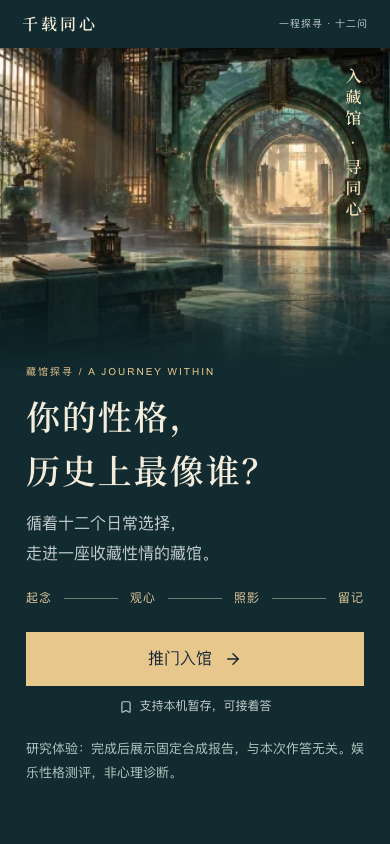
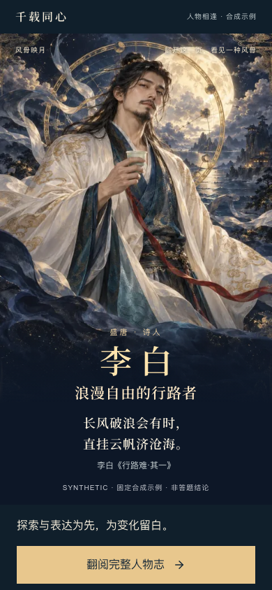
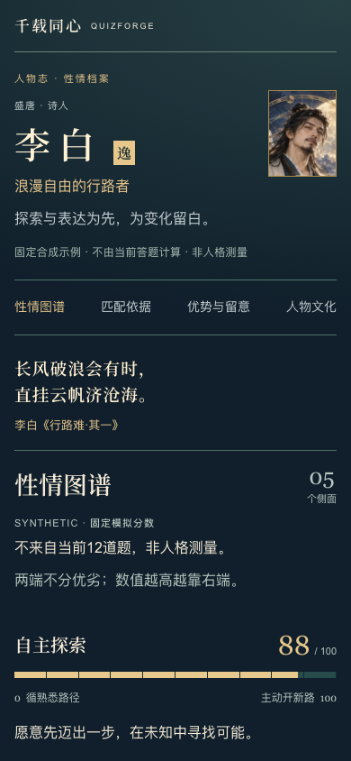

<div align="center">

# QuizForge

**让每一款测评，都有自己的内容、视觉与体验。**

面向移动端 H5 的趣味测评商品研发与运营平台。<br>
从精品内容与 QuizPack 商品包，到独立主题、确定性评分和可收藏的结果报告。

**Next.js · React · TypeScript · Tailwind CSS · PostgreSQL**

[体验预览](#体验预览) · [当前能力](#当前能力) · [快速开始](#快速开始) · [开发与验证](#开发与验证) · [文档导航](#文档导航)

</div>

---

> **当前状态：首款本地内测完成。** F1–P5 已合入 `main`，历史人物测评《千载同心》已走通导入、审核封存、Key 发放、答题恢复、确定性报告与 PNG 导出。当前仍为内测工程，尚未对外部署或商业发布。最新证据见 [阶段进度](docs/PROGRESS.md) 与 [内测归档](docs/releases/P5_INTERNAL_BETA_1.md)。

## 体验预览

以历史人物主题为起点，把一次测评做成一段「入馆 · 探寻 · 相逢 · 收藏」的旅程。

<table>
  <tr>
    <th align="center">入馆 · 情境封面</th>
    <th align="center">相逢 · 人物揭晓</th>
    <th align="center">细读 · 人物志</th>
  </tr>
  <tr>
    <td align="center"></td>
    <td align="center"></td>
    <td align="center"></td>
  </tr>
</table>

以上为仓库已收录的 **D1-C 合成研究演示**，截图视口为 390 × 844，浏览器为 Chromium；展示固定示例，不随本次答案计算，也不是 P5 用户报告。素材来源与批准范围按对应清单记录，不代表获得商业使用授权。[查看完整截图与验收](docs/D1C_ACCEPTANCE.md)。

启动本地服务后，打开 [历史人物演示](http://127.0.0.1:3000/studies/visual-v2-c)，即可体验封面、四厅十二题、本机恢复、合成报告和真实 PNG 导出，无需配置数据库。

## 项目理念

- **一款测评，一套完整体验。** 内容、主题、布局、交互与报告共同构成商品，支持商品专属组件与视觉配方。
- **精品研发，标准交付。** Codex 负责内容与体验研发，QuizPack 承载版本化商品包，QuizForge 负责验证、运行和运营。
- **结论可复现，报告可回看。** 由确定性引擎产生结果，完成后封存报告快照；历史查看读取同一份报告。
- **AI 按需参与。** 后台 AI 是可选辅助。规划中的 AI 文案增强不能改分数、人物或结论，失败时回退完整基线报告。

目标生产流程：

```text
精品研发 → QuizPack 验证 → 隔离导入 → 可视预览 → 人工审核 → 发布
```

当前已经完成到内测版本封存与消费者内测闭环；商业发布仍需后续验收与授权。

## 当前能力

| 领域       | 已实现并有阶段验收记录的范围                                      | 证据                                                            |
| ---------- | ----------------------------------------------------------------- | --------------------------------------------------------------- |
| 商品包     | 有限内容合同、受限 ZIP 构建与验证、隔离媒体验证、私有资源归档     | [P1](docs/P1_ACCEPTANCE.md) · [P3-B](docs/P3B_ACCEPTANCE.md)    |
| 运营工作区 | 独立登录、测评目录、分类标签、导入记录、不可变草稿修订            | [P2-A](docs/P2A_ACCEPTANCE.md) · [P3-D](docs/P3D_ACCEPTANCE.md) |
| 预览与审核 | 固定修订可视预览、批准基线记录、内测版本封存                      | [P3-C](docs/P3C_ACCEPTANCE.md) · [P3-E](docs/P3E_ACCEPTANCE.md) |
| 消费者流程 | AccessKey 验证、保存与恢复、每枚 Key 一次正式完成、原链接只读回看 | [P4](docs/P4_ACCEPTANCE.md)                                     |
| 评分与报告 | 确定性评分、不可变报告快照、人物长报告、1080 × 1920 PNG 导出      | [P5](docs/P5_ACCEPTANCE.md)                                     |

首款《千载同心》的内测基线包含 **12 题、48 个选项、4 个维度、4 位人物结果**，四组见证已完成真实流程验证。七宗罪与动物人格仍保留为主题研究方向，不代表已经具备同等完整的商品能力。

待完成事项包括商业素材授权、对外部署与发布、支付和渠道履约、AI 辅助，以及上线前的数据备份恢复验收。路线图是计划，具体实现状态以 [PROGRESS](docs/PROGRESS.md) 为准。

## 快速开始

### 1. 准备环境

- Node.js：满足 `package.json` 的 `>=20.19.0 <21 || >=22.13.0`；CI 使用 Node 24。
- pnpm：项目固定 **10.32.1**，通过 Corepack 调用。
- Git 与 Corepack；不需要为此项目修改全局 Node / pnpm 配置。

### 2. 安装并启动

```sh
git clone https://github.com/aning0922/quiz-forge.git
cd quiz-forge
corepack pnpm install --frozen-lockfile
corepack pnpm dev
```

已有检出时，直接在仓库根目录执行安装与启动命令。默认地址为 [127.0.0.1:3000](http://127.0.0.1:3000)，以终端实际输出为准。

研究页面与生产构建不需要数据库配置。运营后台和消费者内测需要独立的本机运行环境，配置入口见下方「本机运营与数据库」。

### 3. 选择入口

| 入口             | 路由                                             | 运行条件                           |
| ---------------- | ------------------------------------------------ | ---------------------------------- |
| 平台首页         | `/` · `/search` · `/works`                        | 浏览无需数据库；美术见下方配置     |
| 我的／兑换入口   | `/my`                                            | 兑换需要内测配置及有效 Key         |
| 千载同心公开封面 | `/works/qianzai-tongxin`                          | 浏览无需数据库                     |
| 工程研究入口     | `/studies`                                       | 无需数据库                         |
| 三主题研究板     | `/themes`                                        | 无需数据库                         |
| 历史人物合成体验 | `/studies/visual-v2-c`                           | 无需数据库；固定合成结果           |
| 历史视觉方案留档 | `/studies/historical`                            | 无需数据库                         |
| 运营登录与工作区 | `/studio/login` · `/studio/products`             | 专属数据库、私有运行配置与运营身份 |
| 消费者内测入口   | `/access`                                        | 已准备的内测版本与有效 Key         |
| 答题与只读报告   | `/play/[sessionId]` · `/play/[sessionId]/report` | 对应的有效访问授权                 |

正式消费者流程需要验证对应商品的 AccessKey，普通买家不强制注册。研究演示与持久化消费者流程分别运行，不能用演示的本地状态证明正式完成。

平台首页沿用已确认的 V2 原型。`QUIZFORGE_PLATFORM_ART_DIR` 指向本机私有营销素材目录，包含 `src/features/platform-home/art-manifest.ts` 登记的五个固定文件及准确哈希；素材不随公开仓库分发。未配置或校验失败时显示缺图说明与可用入口，不替换成其他美术。浏览首页无需数据库；真实兑换另需本工作树受管 `QUIZFORGE_P2A_CONFIG` 和已发放的有效 AccessKey，原型演示码不被接受。

## 开发与验证

所有命令从当前仓库或受管 worktree 的根目录执行，先核对 `git status` 与 `git remote -v`。

验证范围统一按 [AGENTS.md](AGENTS.md) 的风险分级选择。以下是工具入口，不是每次交付都要运行的清单：文档和低风险展示改动不触发全量测试；相关验证输入未变化时复用已有成功结果。修复后先验证原失败点及直接影响，达到本批验收条件即收口，不为覆盖率或检查数量扩大范围。

| 命令                             | 用途                                         |
| -------------------------------- | -------------------------------------------- |
| `corepack pnpm dev`              | 启动本地开发服务                             |
| `corepack pnpm format:check`     | 检查格式                                     |
| `corepack pnpm lint`             | ESLint 检查，警告视为失败                    |
| `corepack pnpm typecheck`        | 生成路由类型并执行 TypeScript 检查           |
| `corepack pnpm test`             | 单元测试                                     |
| `corepack pnpm build`            | 实现登记校验、生产构建与私有路径 trace 审计  |
| `corepack pnpm test:e2e:install` | 首次安装项目内 Chromium                      |
| `corepack pnpm test:e2e`         | 生产构建上的受管端到端测试                   |
| `corepack pnpm check`            | 确需全量时顺序执行六项检查，不作日常默认入口 |

**完整 E2E 需要专属 `test` / `ci` 数据库、私有运行配置及就绪的媒体环境，并独占端口 3100。** 不能复用正在运行的作者体验服务，也不能把未配置环境造成的跳过或失败记为通过。环境与执行证据见 [P4 验收](docs/P4_ACCEPTANCE.md)。

GitHub Actions 在 `main` 推送、PR 和手工触发时执行冻结安装与工程检查，并用隔离数据库运行迁移、集成和故障测试。现有通用 workflow 未按文档或局部 UI 改动裁剪；这不要求本地预先重复同一套检查，也不应手动重复触发已成功的工作流。具体提交的远端结果以 [Actions](https://github.com/aning0922/quiz-forge/actions) 为准；本地成功、远端成功和人工视觉验收分别记录。

<details>
<summary><strong>本机运营与数据库</strong></summary>

先阅读 [数据库运行说明](docs/P2A_DATABASE_IMPLEMENTATION.md)、[认证说明](docs/P2A_AUTH_IMPLEMENTATION.md) 和 [内测环境恢复边界](docs/releases/P5_INTERNAL_BETA_1.md)。当前本机管理工具绑定 Homebrew PostgreSQL 18.4，属于隔离内测环境。

- `p2a:db init` 创建全新的项目专属实例，不是恢复旧数据；不能复用已有数据库或 5432。
- 唯一应用配置入口为 `QUIZFORGE_P2A_CONFIG`，指向**当前工作树内**受管实例的私有 `runtime.json` 绝对路径。应用不回退到 `DATABASE_URL`。
- 完整 E2E 的实例 origin 必须为 `http://127.0.0.1:3100`，用途为 `test` / `ci`；人工查看可使用单独的 `demo` 实例。
- `corepack pnpm test:db` 连接真实隔离库，缺配置或实例不可用会失败。驱动回归另外使用 `QF_DRIVER_TEST_INSTANCE` 和 `test:driver`。
- 当前运营身份使用账号密码。通过 `pnpm studio:accounts bootstrap-admin` 明确指定新实例、账号 UUID、原操作 UUID、登录名、显示名和私有 `--operation-file` 文件，再由本人设置密码；后续开通人员由管理员后台完成。维护与原操作核实见 [账号合同](docs/STUDIO_ACCOUNTS_V1.md)。旧随机凭证命令已移除。
- R1 的 18 条迁移备份合同只适用于其历史归档版本；当前账号结构不承诺由 R1 恢复，旧 `runtime:recovery` 入口已退出当前命令。历史实例与封存证据保持，见 [历史恢复边界](docs/RUNTIME_OPERATIONS.md)。
- 原实例启停、媒体环境准备与私有资源保留须遵循已有身份约束。新 clone / worktree 不能直接复用另一工作树的运行配置。

</details>

<details>
<summary><strong>内容合同与 QuizPack 工具</strong></summary>

```sh
# 检查仓库内的合成参考内容
corepack pnpm --silent foundation:check src/features/quizpack/fixtures/historical.foundation.json --product historical-synthetic

# 导出结构合同
corepack pnpm --silent foundation:schema
corepack pnpm --silent quizpack:schema

# 以下为参数示例：替换为实际文件与 Product ID
corepack pnpm --silent quizpack:check example.quizpack --product example-product
corepack pnpm --silent quizpack:build input.json --product example-product --out example.quizpack
```

输入清单、限额、拒绝边界与输出回执见 [包工具说明](docs/P1_TOOLCHAIN_IMPLEMENTATION.md)。本地技术校验成功不授予导入或发布权限；素材来源与授权声明仍须审核。

</details>

<details>
<summary><strong>测试产物与排查</strong></summary>

- Chromium 缓存位于 `.cache/ms-playwright/`。
- E2E 原始产物与 HTML 报告位于被 Git 忽略的 `test-results/`、`playwright-report/`；使用 `corepack pnpm exec playwright show-report` 查看报告。
- `typecheck` 会先运行 `next typegen`，干净检出不依赖已有 `.next`；`next-env.d.ts` 与生成的路由类型不入库。
- `build` 会校验受控实现身份并审计实际部署 trace，拒绝私有状态路径进入部署产物。
- 程序断言和截图产物不能代替作者视觉、内容或商业素材批准。

</details>

## 工程结构

模块化单体，使用 Next.js App Router 与 TypeScript strict。默认 Server Components，浏览器交互按需使用 Client Components。

```text
src/
├── app/                 # 路由与组合：研究、运营、消费者分别布局
├── components/ui/       # 领域无关的通用基础组件
├── features/
│   ├── quiz/            # 内容、版本与确定性评分
│   ├── quizpack/        # 商品包合同、构建、验证与导入
│   ├── theme/           # 主题、视觉配方与专属体验
│   ├── report/          # 结果快照、报告与海报
│   ├── product/         # 商品工作区、修订与版本
│   ├── studio/          # 运营认证与后台界面
│   ├── ai-generation/   # 可选 AI 草稿与增强边界
│   └── fulfillment/     # 渠道与幂等履约边界
├── lib/                 # 共享工具与服务端基础设施
└── config/              # 工程元信息
public/assets/           # 已收录研究素材、字体与来源清单
tests/                   # 分层验证与端到端测试
docs/                    # 架构、合同、验收与阶段证据
```

领域模块不反向依赖 `app`，通用 UI 不引用商品配置。商品专属组件在主工程内审核并通过受控 ID / 版本登记；QuizPack 不携带可执行源代码、任意 HTML 或动态模块。

## 文档导航

| 想了解什么             | 从这里开始                                                                                                                    |
| ---------------------- | ----------------------------------------------------------------------------------------------------------------------------- |
| 项目定位与实际进度     | [产品愿景](docs/PRODUCT_VISION.md) · [阶段进度](docs/PROGRESS.md) · [内测归档](docs/releases/P5_INTERNAL_BETA_1.md)           |
| 如何参与与维护         | [工程规则](AGENTS.md) · [托管范围](docs/MANAGED_DEVELOPMENT.md) · [技术决策](docs/DECISIONS.md)                               |
| 模块、数据与资源归属   | [架构](docs/ARCHITECTURE.md) · [数据模型](docs/DATA_MODEL.md) · [测评资源](docs/ASSESSMENT_RESOURCES.md)                      |
| 内容包与评分合同       | [F1 底座](docs/FOUNDATION_F1.md) · [QuizPack 规格](docs/QUIZPACK_SPEC.md) · [P1 合同](docs/QUIZPACK_P1.md)                    |
| 审核、版本与消费者流程 | [内测版本](docs/INTERNAL_VERSION_P3E.md) · [消费者合同](docs/CONSUMER_P4.md) · [报告模式](docs/REPORT_MODES.md)               |
| 视觉与内容基线         | [视觉系统](docs/VISUAL_SYSTEM.md) · [视觉验收](docs/D1_VISUAL_ACCEPTANCE.md) · [首款批准基线](docs/FIRST_PRODUCT_BASELINE.md) |
| 后续方向与研究         | [阶段路线（计划）](docs/ROADMAP_30D.md) · [开源复用研究](docs/OPEN_SOURCE_REUSE_PLAN.md)                                      |

---

QuizForge 的趣味测评用于娱乐与自我探索，不作心理诊断或科学诊断承诺。代码可见性、工程验证与素材商业授权是不同事项；第三方经营、支付与履约接入仍需单独确认。
